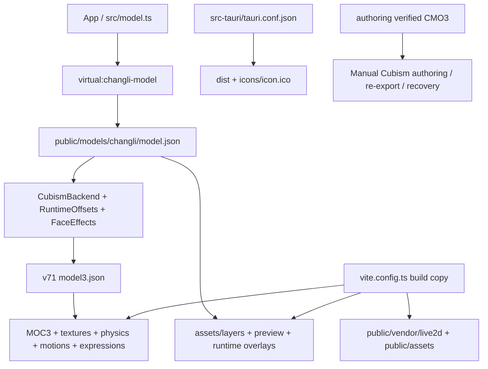

# Current runtime and authoring dependency map

`vite.config.ts` disables the broad public copy for production and copies only the active runtime folder plus runtime art/Core. `src/model.ts` uses a virtual manifest; `src/renderer/live2d/` loads the model3 entry. The Tauri bundle consumes `dist`, its icon and runtime license. No application import, package command, Vite resource copy or Tauri configuration consumes `authoring/*.cmo3`.

The editable source is required to resume editing/re-exporting, so preservation remains mandatory. It is not interchangeable with the compiled MOC3. Historical authoring tools may require other local sources; those are outside the current application build.

`npm run check:repository` verifies the source allowlist, asset references and icon; after `npm run build`, `node scripts/check-repository.mjs --dist` verifies the same runtime model graph in the built package. These are file checks, not a Core/WebGL/native acceptance test.
